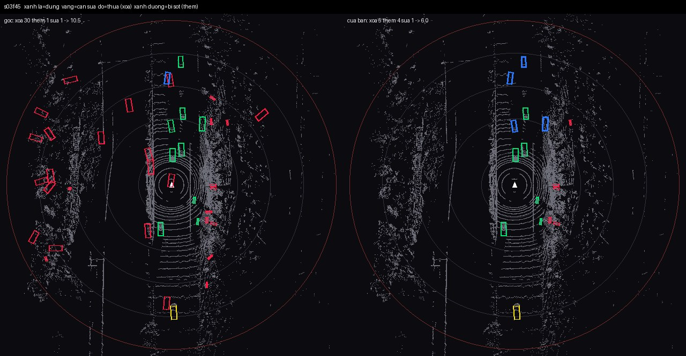

# Báo cáo Day 14 — Nguyễn Phương Nga — 2A202603335

- Mã học viên dùng với `--student`: `335`
- `seed_tag` trong `frames_A.txt`: `82ac3100fd`

## 1. Dự đoán trước sweep (bước 5b)

Ghi **trước** khi chạy `scripts/pp_sweep.py`, rồi commit và push ngay (lịch sử commit là bằng chứng thời điểm viết). Không sửa phần này sau khi có kết quả.

- Tham số tôi nghĩ giảm công sửa nhiều nhất: score_thr = 0.5
- Vì sao (nhìn ảnh BEV tập A: box thừa nhiều hay box sót nhiều?): thừa nhiều (khá nhiều box rác, bị lẫn vào bụi cây)

## 2. Tập A: sửa tay và tune

| Cấu hình | Xóa | Thêm | Sửa | Chi phí |
|---|---:|---:|---:|---:|
| Gốc (`score_thr=0.1`, `min_points=0`) | 71 | 8 | 4 | 31.3 |
| `best_config.json` (`score_thr=0.5`, `min_points=0`) | 13 | 14 | 4 | 19.9 |

- Tham số đã đổi trong `best_config.json`: `score_thr: 0.1 -> 0.5` (`min_points` giữ ở `0`; các tham số khác giữ nguyên mặc định).
- Kết quả leave-one-out (dán các dòng `scripts/pp_sweep.py` in ra):
  - `s03f45: cấu hình chọn {'score_thr': '0.5', 'min_points': '0'} → 6.0 (tốt nhất có thể 5.9)`
  - `s04f59: cấu hình chọn {'score_thr': '0.5', 'min_points': '0'} → 9.8 (tốt nhất có thể 8.3)`
  - `s05f37: cấu hình chọn {'score_thr': '0.4', 'min_points': '0'} → 5.3 (tốt nhất có thể 4.1)`
- Cấu hình có ổn định trên từng frame không? Vì sao tôi vẫn chọn (hoặc không chọn) nó: Cấu hình `score_thr=0.5` không hoàn toàn ổn định trên từng frame riêng lẻ: giảm chi phí rất mạnh ở `s03f45` (`10.5 -> 6.0`) và `s05f37` (`12.5 -> 4.1`), nhưng lại làm tăng chi phí ở `s04f59` (`8.3 -> 9.8`) do lọc nhầm một số đối tượng thật có điểm tin cậy trung bình. Tuy nhiên, tôi vẫn chọn cấu hình này vì trên tổng thể cả 3 frame, nó giúp cắt giảm tới 58 box rác (`71 -> 13`), kéo tổng chi phí sửa giảm 36% (`31.3 -> 19.9`) và phù hợp nhất với bài toán loại bỏ nhiễu nền.

## 3. Trước/sau (bước 8)

- `scripts/pp_compare.py` báo giảm 36% công sửa trên tập A (`31.3 -> 19.9`; từng frame: `s03f45` `10.5 -> 6.0`, `s04f59` `8.3 -> 9.8`, `s05f37` `12.5 -> 4.1`).
- Dự đoán ở mục 1 đúng hay sai? Giải thích bằng số box xóa/thêm/sửa: Dự đoán ở mục 1 là **đúng**. Khi tăng `score_thr` từ `0.1` lên `0.5`, số box thừa phải xóa giảm mạnh từ `71` xuống `13` (giảm 58 box nhiễu ở bụi cây/nền), trong khi số box sót phải thêm mới chỉ tăng nhẹ từ `8` lên `14` (tăng 6 box) và số box phải sửa kích thước/vị trí giữ nguyên ở mức `4`. Nhờ trọng số xóa được giảm đáng kể mà ít phát sinh thêm mới, tổng chi phí sửa giảm 36%.

## 4. Tập B

Số đo từ `scripts/pp_prelabel.py --frames d14_335/frames_B.txt --config d14_335/best_config.json --gt d14_335/ref_B.json`:

| Xóa | Thêm | Sửa | Chi phí |
|---:|---:|---:|---:|
| 38 | 19 | 34 | 47.4 |

- Loại box tốn công sửa nhất ở tập B: Nhiều nhất là nhóm `Car` (phải thao tác sửa khá nhiều do vừa bị dự đoán thiếu box, vừa có nhiều box bị lệch độ cao/lơ lửng so với mặt đất), tiếp theo là nhóm `Bus`/`Truck` (mô hình gần như bỏ sót toàn bộ nên phải vẽ mới thủ công).

## 5. Giới hạn

- **Cỡ mẫu tune nhỏ và đánh đổi giữa `score_thr` với `min_points`:** Tập A chỉ có 3 frame nên cấu hình tối ưu chung (`score_thr=0.5`) vẫn làm tăng chi phí cục bộ ở frame `s04f59` (`8.3 -> 9.8`). Ngoài ra, ở ngưỡng `score_thr >= 0.4`, tham số `min_points` (`0, 5, 10`) không còn tạo ra khác biệt nào (`19.9` ở cả 3 mức) vì các box có điểm tin cậy cao đều đã đủ số điểm LiDAR, do đó không giúp lọc thêm được nhiễu đặc.
- **Khoảng cách miền dữ liệu (Domain gap) giữa trọng số KITTI và dữ liệu thực tế:** Mô hình gốc huấn luyện trên tập KITTI không có lớp `Truck`/`Bus` (khiến các xe lớn ở tập B gần như bị sót hoàn toàn hoặc nhận diện sai thành `Car`), đồng thời dễ dự đoán box `Car` bị lơ lửng khỏi mặt đất (`fixed ground_mode`).
- **Hàm chi phí chưa phản ánh đầy đủ thời gian thao tác thực tế:** Công thức `0.3*delete + 1.0*add + 0.5*edit` chỉ ước lượng tương đối; thực tế trên CVAT, việc căn chỉnh lại góc quay và hạ độ cao các box `Car` lơ lửng (34 box sửa ở tập B) hoặc vẽ mới `Bus`/`Truck` mất nhiều thời gian hơn so với thao tác xóa box thừa.